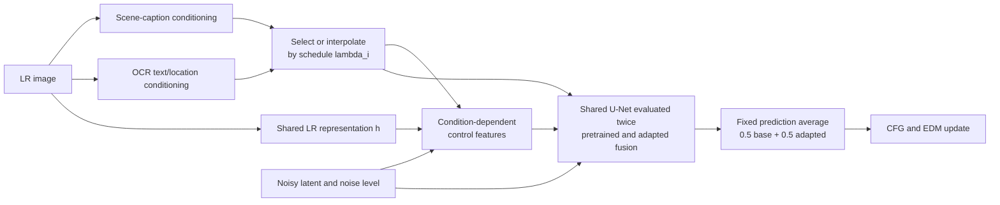

# GLYPH-SR

Official implementation of **A Bi-Objective Framework for Scene Text Super-Resolution: Balancing Legibility and Fidelity**, accepted at **Transactions on Machine Learning Research (TMLR), 2026**.

Mingyu Sung, Seungjae Ham, Kangwoo Kim, Il-Min Kim, Sangseok Yun, and Jae-Mo Kang.

[Paper](https://openreview.net/forum?id=9CnYnByhvB) ·
[Usage guide](docs/guide.md) · [Checkpoints](docs/guide.md#checkpoints)

GLYPH-SR restores scene text while pursuing text legibility and perceptual image
quality as separate objectives. A frozen scene-restoration model is combined with
adapted text-control modules. During sampling, a ping-pong schedule selects
scene-caption or OCR text/location conditioning; continuous schedules interpolate
those conditioning tensors. The shared U-Net is evaluated with pretrained and
adapted fusion modules, and its predictions are averaged with fixed equal weights.
The OCR guider is LLaVA-NeXT 8B with a separately trained LoRA adapter.



Each prompt condition uses the same LR representation; CFG combines positive
and negative prompt evaluations before the EDM update.

## Installation

Restoration uses Linux, Python **3.10**, and NVIDIA GPUs. Install the matching
PyTorch and xformers wheels first, then install the package from this checkout:

```bash
git clone https://github.com/Bluear7878/GYLPH-SR.git
cd GYLPH-SR
conda create -n glyph-sr python=3.10 -y
conda activate glyph-sr
python -m pip install --upgrade pip
python -m pip install torch==2.8.0 torchvision==0.23.0 --index-url https://download.pytorch.org/whl/cu128
python -m pip install xformers==0.0.32.post2
python -m pip install -e '.[runtime]'
```

The default inference placement uses `cuda:0` for SR, `cuda:1` for OCR, and
`cuda:2` for scene captioning. Device options can place components together when memory permits.
Download the components listed in [the guide](docs/guide.md#checkpoints):

```text
checkpoints/
├── juggernautXL_v8Rundiffusion.safetensors
├── SUPIR-v0Q.ckpt
├── TS-ControlNet_cp.ckpt
└── Llava-next_FT/
    ├── adapter_config.json
    └── adapter_model.safetensors
```

The LLaVA base and text encoders use their model caches or configured local paths.

## Restore an image

```bash
glyph-sr infer \
  --input /path/to/low_resolution.png \
  --output-dir ./results/demo \
  --upscale 4 --down-factor 1 \
  --sr-device cuda:0 --ocr-device cuda:1 --caption-device cuda:2
```

`--down-factor 1` uses the supplied LR input. The command writes a restored PNG and
`metadata.jsonl` with the caption, recognized text, and verbalized locations.
The default configuration uses 50 restoration steps and nominal CFG increasing
from 4.0 toward 7.5 as the noise level decreases.

`python -m glyph_sr` provides the same commands. Use `glyph-sr infer --help`,
`glyph-sr train --help`, and `glyph-sr data --help` for all options. See
[the guide](docs/guide.md#training) for the two adaptation stages and data format.

## OCR scoring

Saved OCR predictions can be scored without loading restoration models:

```bash
python -m pip install -e '.[evaluation]'
glyph-sr score --input predictions.jsonl --output scores.json
```

The scorer returns word-matching and exact-word metrics separately. See
[the guide](docs/guide.md#ocr-scoring) for input format, normalization, and metric
definitions.

## Citation

```bibtex
@article{sung2026glyphsr,
  title   = {A Bi-Objective Framework for Scene Text Super-Resolution: Balancing Legibility and Fidelity},
  author  = {Sung, Mingyu and Ham, Seungjae and Kim, Kangwoo and Kim, Il-Min and Yun, Sangseok and Kang, Jae-Mo},
  journal = {Transactions on Machine Learning Research},
  year    = {2026},
  note    = {Accepted},
  url     = {https://openreview.net/forum?id=9CnYnByhvB}
}
```

Machine-readable metadata is available in [CITATION.cff](CITATION.cff).

## Acknowledgements and terms

This work was supported by the National Research Foundation of Korea(NRF) grant
funded by the Korea government(MSIT) (RS-2026-25493331).

The implementation builds on [SUPIR](https://github.com/Fanghua-Yu/SUPIR),
[LLaVA-NeXT](https://github.com/LLaVA-VL/LLaVA-NeXT),
[generative-models](https://github.com/Stability-AI/generative-models), and
[Nunchaku](https://github.com/nunchaku-tech/nunchaku). Their code and model terms
remain applicable. See [third-party provenance](THIRD_PARTY_NOTICES.md) and the
retained license notices for code and model terms.
